# portfolio-risk-covariance

**A comparative study of covariance estimators for risk forecasting and portfolio construction.**

Five covariance estimators-  sample covariance,  linear and nonlinear shrinkage, RMT-based covariance cleaning and cDCC-GARCH model- are evaluated out of sample across equal-weight, risk-parity, long-only and long-short minimum-variance portfolios comprising 75-instrument multi-asset panel over 2015–2025, on three questions: how accurately they forecast portfolio risk, how good the portfolios built from them are, and how robust both are across market regimes.

> **Status:** the evaluation engine, the full backtest and the first results are complete. The written model-review memo and some robustness extensions are in progress (see [Roadmap](#status-and-roadmap)). Results below are therefore **preliminary**.

---

## Why this study

Covariance estimation is a first-class problem in its own right, independent of expected returns. Risk limits, VaR and expected shortfall, tracking error and stress tests all rest on a covariance forecast, and the most widely used return-free portfolio constructions (minimum variance, risk parity) depend on nothing else. In large panels the sample covariance is known to be a poor input for optimisation, and a family of alternatives exists, each aimed at a different failure mode: **estimation noise** across many assets (shrinkage, random-matrix cleaning) or **time variation** in risk (multivariate GARCH). This study measures, on realistic multi-asset data, which failure mode matters where.


---

## Key findings (preliminary)

All comparisons are against the sample covariance, with 95% paired stationary-bootstrap intervals; numbers are for the 252-day estimation window unless stated. The main results hold at the 504-day window too; exceptions are noted.

**1. For risk forecasting, timing matters most, and cDCC-GARCH wins.** For the equal-weight portfolio, the cleanest forecast test (same portfolio for every estimator), cDCC is the only estimator that significantly improves on the sample covariance: QLIKE difference **−0.46** [−1.03, −0.09], and **−0.46** [−0.92, −0.16] at 504 days. Its advantage builds in shocks (February 2018, March 2020, April 2025) and in what follows them: after COVID, window-based estimators kept forecasting crisis-level risk for a full year, until March 2020 left their windows, while cDCC forgot gradually. The shrinkage estimators improve on the sample covariance at most marginally here (MP's −0.02 is the only other significant difference).

**2. For building minimum-variance portfolios, the sample covariance is a strong baseline on this panel.** No estimator significantly lowers out-of-sample volatility. In long-short minimum variance, QIS on standardised returns comes closest (volatility ratio **0.989** [0.965, 1.009]) and QIS raw ties (1.010); in long-only minimum variance the sample covariance is best. With 75 assets and a 252-day window ($q = p/n \approx 0.3$), estimation noise is real but moderate, and a likely reason is that many of the panel's small eigenvalues are *genuine* hedges (UUP/FXE, EFA/VGK, Treasuries against equities) that shrinkage partly erases. Shrinkage pays off instead in **investability**: standardised Ledoit–Wolf cuts turnover by 45% for 6% more volatility; MP cuts it by 70%, but at a 45% volatility cost.

**3. Eigenvalue clipping and linear shrinkage toward a scaled identity build much riskier portfolios.** Marchenko–Pastur clipping (volatility ratio 1.45 in long-short minimum variance) flattens genuine small eigenvalues along with noise. Ledoit–Wolf on raw returns (ratio 2.58) inflates the variances of quiet instruments, by about 160 times for the T-bill fund at the 252-day window, because its target is set by the volatile ones. Both are equal variants in the study precisely to expose this: QIS on raw returns does not suffer from it, which locates the problem in the linear target, not in shrinkage itself.

**4. Correlation shrinkage hurts risk parity, through a clear mechanism.** Every shrinkage estimator raises risk-parity volatility (ratios 1.12–1.98). Shrinking correlations toward zero makes the 53 strongly correlated equity instruments look more diversified than they are, so risk parity gives them more weight (15.5% for the sample covariance, up to 33.8% for raw Ledoit–Wolf), in the same order as the volatility increase.

**5. Optimised portfolios make their own risk look smaller than it is.** For long-short minimum variance, every estimator forecasts risk far better than the sample covariance (QLIKE −1.8 to −2.5 for the shrinkage estimators, −1.1 for cDCC), because the sample covariance's minimum-variance portfolio exploits its own estimation noise and so looks less risky than it is. As theory predicts, the gap shrinks at 504 days (−0.5 to −0.6 for the shrinkage estimators), when $q$ halves; cDCC's advantage there reverses (+0.7), as the sample covariance's optimism fades. MAE and QLIKE disagree systematically, in the direction Patton (2011) predicts (MAE rewards forecasts that are too low).

**6. One month dominates the minimum-variance comparisons.** In March 2020 the near-cash long-short minimum-variance portfolio (mostly short-dated Treasuries and a dollar/euro pair, with a short position in intermediate Treasuries) turned out 11–19 times riskier in volatility than every estimator forecast. That single holding period accounts for 57% of cDCC's and 70% of QIS's full-sample QLIKE advantage in long-short minimum variance. A detailed case study of cDCC through the crash finds the episode **volatility-driven in magnitude and correlation-driven in duration**: about three-quarters of cDCC's forecast response came through volatilities, but correlations stayed high for months, which re-estimation captured as a jump in correlation persistence from 0.888 to 0.988.

---

## Results at a glance

### Portfolio quality (Criterion B)

Out-of-sample volatility of each estimator's portfolio relative to the sample covariance's (below 1 = less risky), both windows:

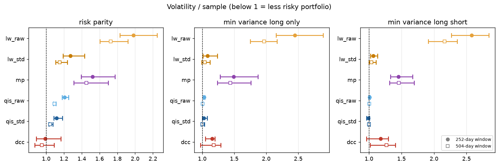

### Risk-forecast accuracy (Criterion A)

QLIKE loss relative to the sample covariance (negative = better forecasts):

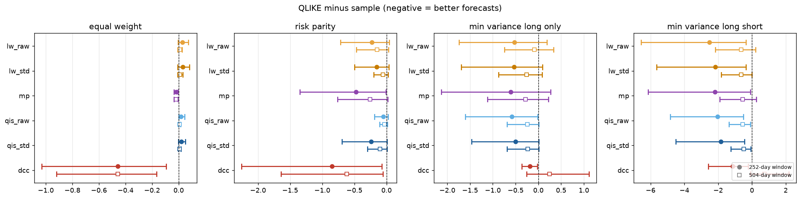

### Timing: forecast against realised risk, equal weight

The sample covariance and QIS stay near 25% for a year after COVID; cDCC follows realised risk down. Close-ups show the COVID and 2025 tariff shocks:

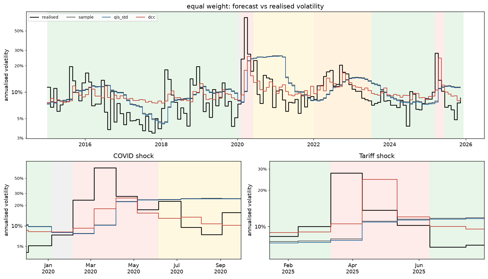

### Where the advantages come from

Cumulative QLIKE difference against the sample covariance: gains arrive in jumps at the shocks, and for the optimised portfolios almost entirely in March 2020:

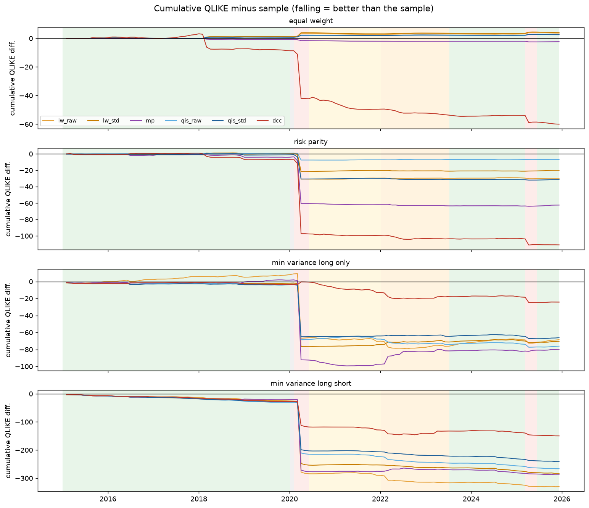

### The risk-parity mechanism

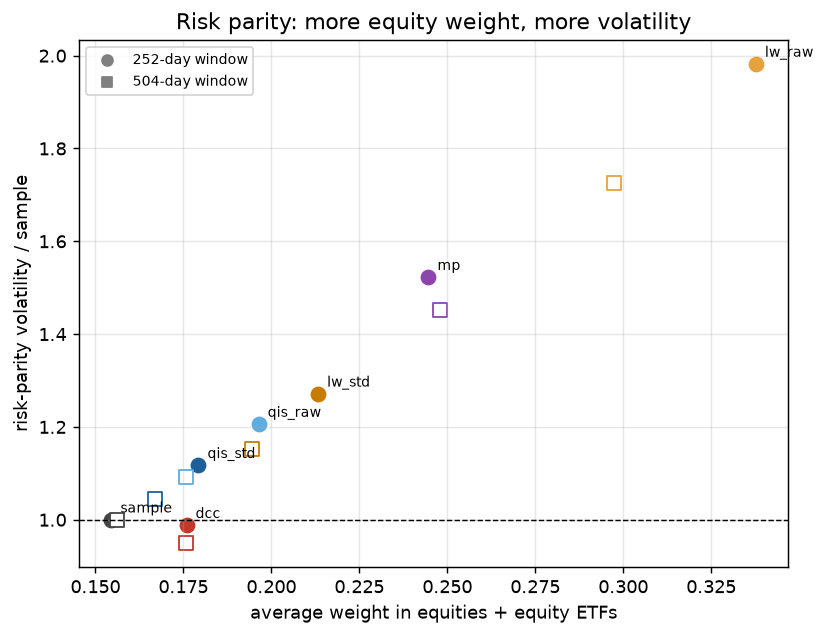

### What minimum variance actually holds

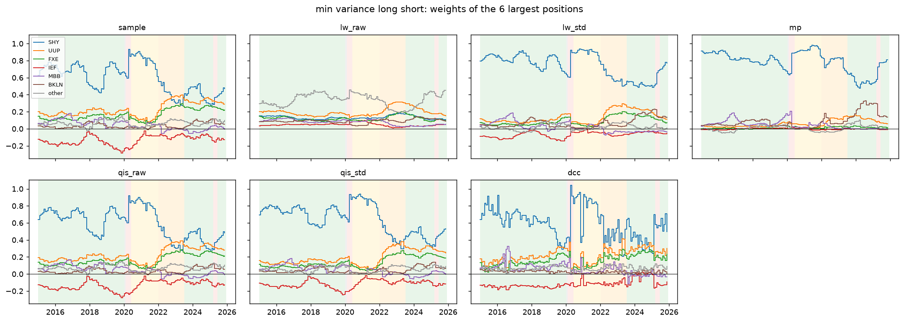

<details>
<summary><b>More figures: forecast accuracy by regime, MAE, and each estimator's own forecast against its own realised risk</b></summary>

**Mean QLIKE by regime** (log colour scale; COVID dominates every portfolio):

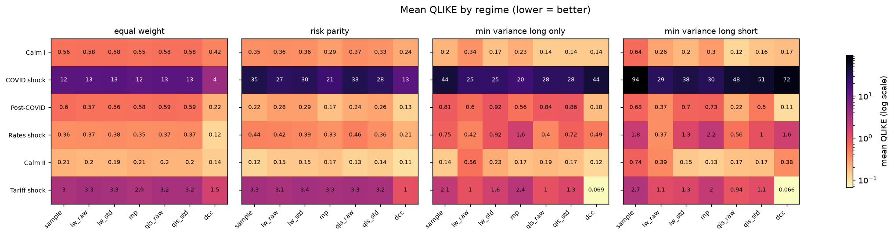

**MAE relative to the sample covariance** (variance units, so panels are not comparable with each other):

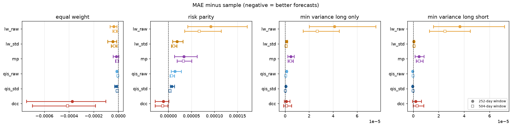

**Each estimator's forecast against the realised volatility of the portfolio it built**, for each optimised portfolio. Realised above forecast means risk was underestimated:

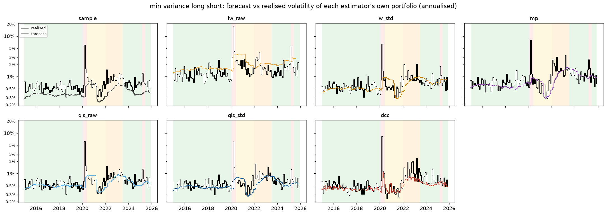

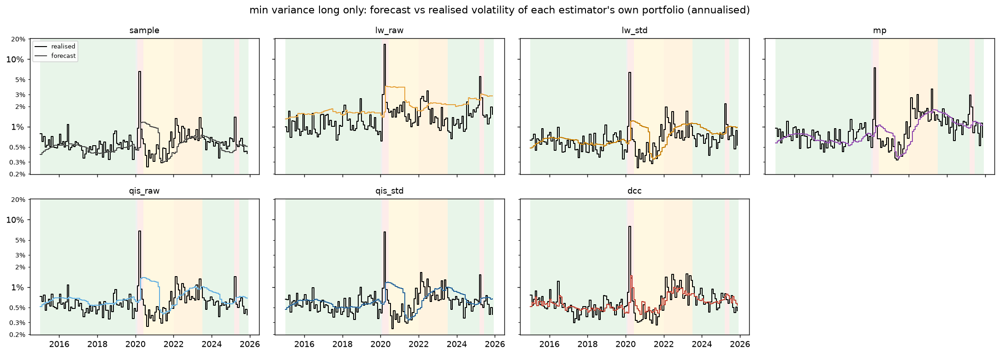

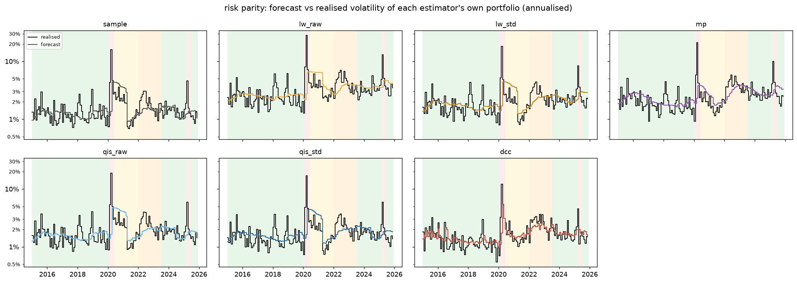

**Risk parity: net weight by asset group over time** (note the rotation out of bonds in the 2022 rates shock):

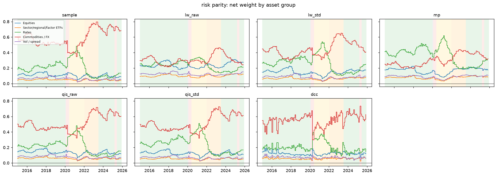

</details>

<details>
<summary><b>cDCC diagnostics</b></summary>

Correlation parameters $(a, b)$ and persistence $a + b$ (with half-life) across refits, GARCH fallbacks, and mean GARCH persistence. Correlation memory is short before 2020 and jumps once the expanding sample contains the COVID crash:

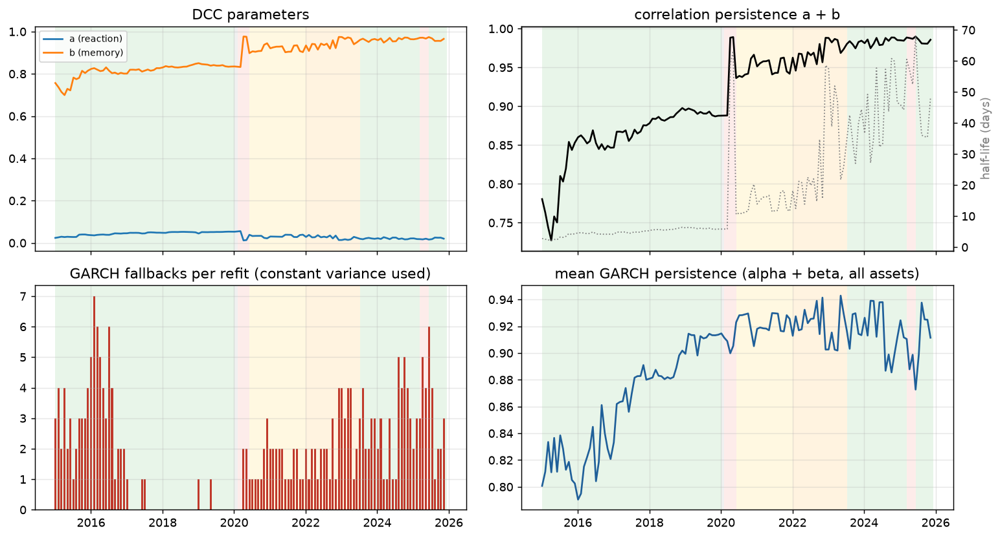

</details>

<details>
<summary><b>Data diagnostics</b></summary>

Computed on 2010–2024 data; to be regenerated on the full 2010–2025 window.

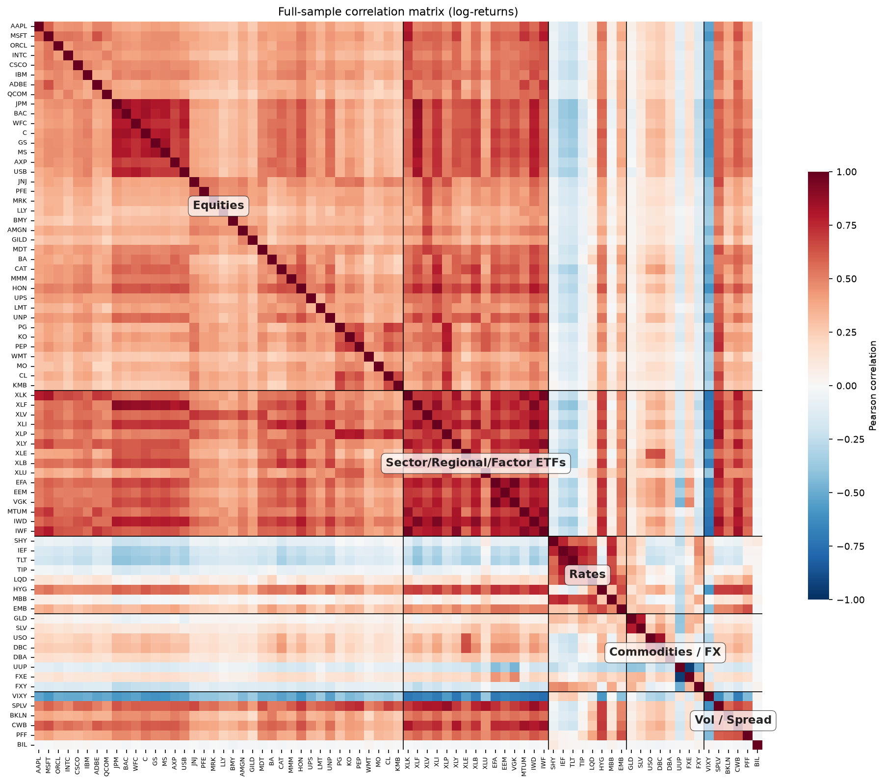

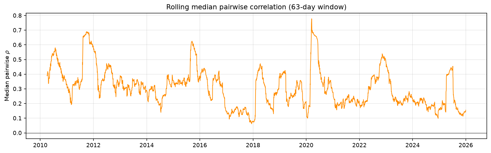

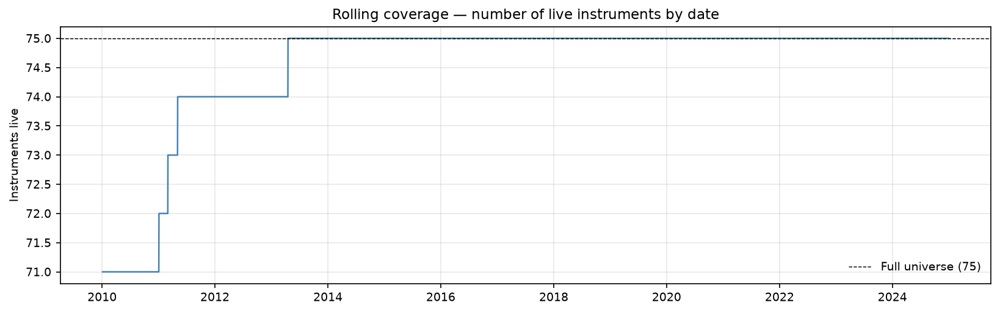

</details>

Figures for the 504-day window are in [`memo/figures/w504/`](memo/figures/w504/); all result tables are in [`memo/tables/`](memo/tables/).

---

## Study design

### Data

75 tradable instruments, daily log returns of adjusted closes from Yahoo Finance, **4 January 2010 to 31 December 2025** (4,024 NYSE trading days):

| Bucket | Instruments |
|---|---|
| US large-cap equities | 38, fixed January 2010 S&P 500 membership, five sectors |
| Sector, regional and factor ETFs | 15 (SPDR sectors, EFA, EEM, VGK, MTUM, IWD, IWF) |
| Rate ETFs | 8 (SHY, IEF, TLT, TIP, LQD, HYG, MBB, EMB) |
| Commodities and FX | 8 (GLD, SLV, USO, DBC, DBA, UUP, FXE, FXY) |
| Volatility, spread and alternative credit | 6 (VIXY, SPLV, BKLN, CWB, PFF, BIL) |

BIL (1–3 month T-bills) serves as cash: it is excluded from the optimised portfolios and used as the risk-free rate.

### Backtest

- **Calendar:** burn-in 2010–2014; first rebalance 31 December 2014; **131 non-overlapping 21-day holding periods** to 9 December 2025. Weights are held constant within each period (Ledoit & Wolf, 2017).
- **Estimation windows:** rolling 252 days (baseline) and 504 days (robustness) for the static estimators; an expanding window from 19 April 2013 for cDCC, refitted at every rebalance.
- **Information set:** each estimator sees returns up to and including the rebalance date only.

### Estimators

| Estimator | Treats | Reference |
|---|---|---|
| Sample covariance | — (baseline) | |
| Ledoit–Wolf, raw returns | Noise (linear shrinkage to scaled identity) | Ledoit & Wolf (2004) |
| Ledoit–Wolf, standardised returns | Noise (linear shrinkage of correlations) | |
| Marchenko–Pastur clipping | Noise (random-matrix eigenvalue cleaning) | Laloux et al. (1999) |
| QIS, raw returns | Noise (nonlinear shrinkage) | Ledoit & Wolf (2022) |
| QIS, standardised returns | Noise (nonlinear shrinkage of correlations) | |
| cDCC-GARCH | Time variation (GARCH(1,1) volatilities, corrected DCC correlations, composite likelihood) | Engle (2002); Aielli (2013); Pakel et al. (2021) |

### Portfolios

Equal weight (estimator-independent: the clean forecast test), risk parity, and minimum variance long-only and long-short (estimator-dependent: the consistency test).

### Evaluation criteria

- **A, risk-forecast accuracy** (all portfolios): 21-day forecast against realised variance. QLIKE and MAE co-primary; bias ratio; log-log Mincer–Zarnowitz calibration slope with Newey–West errors; Diebold–Mariano tests.
- **B, portfolio quality** (optimised portfolios): out-of-sample volatility of excess returns over BIL (primary); turnover (DeMiguel, Garlappi & Uppal, 2009), concentration, gross exposure, Sharpe ratio.
- **C, regime robustness:** A and B recomputed in six regimes (two calm periods, the COVID shock, post-COVID, the 2022–23 rates shock, the 2025 tariff shock), with rank stability (Kendall's W).
- **Uncertainty:** paired stationary block bootstrap (Politis & Romano, 1994), 2,000 replications, mean blocks of 3 periods (A) and 63 days (B), with block-length sensitivity at 6–12 periods and 21–126 days.

The full specification is in [`docs/02-evaluation-design.md`](docs/02-evaluation-design.md).

---

## Repository structure

```
portfolio-risk-covariance/
├── src/portfolio_risk/
│   ├── data/           acquisition, NYSE calendar, cleaning, returns, manifest
│   ├── analysis/       data diagnostics
│   ├── estimators/     sample, Ledoit–Wolf, MP clipping, QIS, cDCC-GARCH
│   ├── portfolios/     equal weight, minimum variance (LO/LS), risk parity
│   └── evaluation/     schedule, config, backtest, metrics, bootstrap,
│                       regimes, report, figures, run (command line)
├── tests/              471 tests (pytest), mirroring src/
├── scripts/            case-study scripts (cDCC through the COVID crash)
├── docs/               design documents and the methodology note
├── memo/               result tables and figures (per window)
├── notebooks/          data diagnostics
└── data/               manifest only (prices and returns are re-fetched)
```

---

## Reproducing the results

Requires Python 3.14.

```bash
python -m venv .venv
source .venv/bin/activate            # Windows: .venv\Scripts\Activate.ps1
pip install -r requirements-dev.txt
pip install -e .
```

Then, from the project root:

```bash
python -m portfolio_risk.data.acquisition                 # fetch and clean the panel (~30 s)
python -m portfolio_risk.evaluation.run --window 252      # backtest + all tables
python -m portfolio_risk.evaluation.run --window 504
python -m portfolio_risk.evaluation.figures --window 252  # all figures (seconds)
python -m portfolio_risk.evaluation.figures --window 504
```

Fitted matrices are cached in `data/cache/`. Results are written to `data/results/` (backtest outputs), `memo/tables/` and `memo/figures/`.

The COVID case study is reproduced with:

```bash
python scripts/dcc_decomposition.py 2020-03-05 9
python scripts/dcc_decomposition.py 2020-04-03 30
```

**Data note.** Price data is not committed: it is re-fetched from Yahoo Finance on every run, and `data/manifest.yaml` records SHA-256 hashes of the panel used for the published results. Yahoo retroactively re-adjusts prices after dividends and splits, so a later fetch can differ slightly; the manifest shows whether it does.

**Quality checks:**

```bash
pytest -q
mypy src/portfolio_risk/
```

---

## Documentation

- [`docs/01-data-acquisition-design.md`](docs/01-data-acquisition-design.md): universe, sources, calendar, cleaning rules.
- [`docs/02-evaluation-design.md`](docs/02-evaluation-design.md): backtest calendar, criteria, bootstrap, engine structure.


---

## Status and roadmap

**Complete:** data pipeline; five estimators with property tests (cross-checked against reference implementations where they exist); four portfolio constructions; backtest engine with caching and per-fit diagnostics; Criteria A, B and C with paired bootstrap intervals; full runs at both windows; first batch of figures; methodology note.

**In progress:**
- the model-review memo (results by criterion, fitness for purpose by use case, limitations);
- a second batch of figures: risk against turnover, rolling volatility, volatility ratio by regime;
- a risk-contribution metric for risk parity, whose goal is equal risk contributions rather than minimum volatility;
- robustness views: Criterion A excluding the COVID periods, minimum variance on the equity-only universe, and the dimensionality stress test (random subsets of 30–75 assets);
- cDCC checks: refitting with all pairs (or a different ordering) in the composite likelihood, the GARCH fallbacks after 2022, a Monte Carlo check of the forecast approximations, and a direct split of realised COVID risk into volatilities and correlations;
- regenerating the data diagnostics on the 2010–2025 window.

---

## Limitations

- **Survivorship:** equities are fixed at January 2010 S&P 500 membership, filtered for continuity through 2025. This is acceptable for a comparison (every estimator sees the same panel) but not for absolute performance claims.
- **Noisy benchmark:** realised variance from 21 daily returns has a relative error of at least 31% (about 40–60% for real portfolios), so conclusions rest on averages over 131 periods and on paired comparisons.
- **No transaction costs:** turnover is reported so any cost assumption can be applied.
- **Daily data and monthly rebalancing:** intraday effects are pooled, and forecasts are fixed for 21 days, which limits how quickly any estimator can respond within a holding period.
- **Universe:** US-centric and moderate-dimensional ($p = 75$); results for estimators designed for $p \gtrsim n$ may differ on larger universes.
- **Free data source:** Yahoo Finance adjusted prices, with outlier flagging and coverage checks.


---

## License
 Author: Marco Serra.
